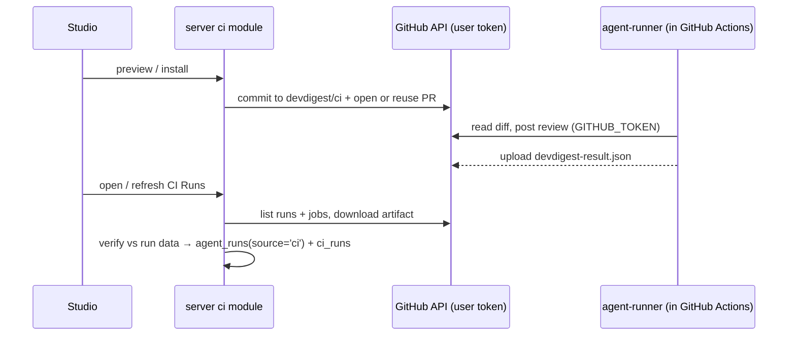

# Spec: Export to CI, v1 (worktree B)
Spec ID: SPEC-15
Status: draft
Supersedes: specs/L06-export-to-ci.md

> **Scope of v1.** This is a deliberately minimal first slice. The user asked
> not to overcomplicate it and to iterate later. Everything that was cut is
> listed in "Deferred / not in v1" at the end.
>
> **Lesson.** The user set the lesson to L07. Root `README.md:89-90` still
> lists "Export to CI" under L06, so the README table is out of date. This is
> not blocking.
>
> **Design input.** Five mocks, all **outside the repo**. Copy them to
> `specs/assets/L07-export-to-ci/1.png` … `5.png`:
>
> | Ref | Source (Windows temp dir) | Shows |
> |---|---|---|
> | `1.png` | `emdash-drop-a009c5dd-…-paste.png` | Agent → **CI** tab |
> | `2.png` | `emdash-drop-31f4fbb1-…-paste.png` | Wizard step 1, Target |
> | `3.png` | `emdash-drop-12ea5f91-…-paste.png` | Step 2, Preview |
> | `4.png` | `emdash-drop-b6aac244-…-paste.png` | Step 3, Configure |
> | `5.png` | `emdash-drop-f03ffa0e-…-paste.png` | Step 4, Install |
>
> **No design exists** for the CI Runs page, the CI tab's version/history/Fail
> CI on, or any loading/empty/error/success state. Criteria that cover these
> are marked *(no design)* and use plain tables and inline messages.

## Problem and user

**INSIGHTS loaded:**

- `server/INSIGHTS.md`:
  - (2026-10-08) changing skills does not bump `agents.version`. In v1 a
    manifest's version is the agent version only, accepted as coarse.
  - (2026-09-21) cross-module data goes through `container.<x>Repo`.
  - (2026-09-22) a new Service ↔ `container.ts` cycle needs one baseline
    entry.
  - (2026-09-30) `server/test/**` is not type-checked. `rg` it when
    extending a contract.
  - (2026-09-21) duplicate `export *` names vanish from the contracts barrel.
  - (2026-10-09) the stale-run sweep reaps `running` rows, so CI rows are
    inserted already finished.
- `client/INSIGHTS.md`:
  - Use `SeverityBadge`, never a local color map.
  - Sync the vendor copy from the server copy.
- `agent-runner/insights/INSIGHTS.md`: the open question "`post_as` never
  reaches the runner" is closed by crit. 12.
- Root `INSIGHTS.md` and `reviewer-core/INSIGHTS.md`: nothing bears on this
  task.

**Who.** A team lead whose tuned agent runs only on their machine, so the
team can't rely on it for every PR.

**What exists (verified):**

- **The runner is already built.** `agent-runner/` validates
  `.devdigest/agents/*.yaml` with the shared `AgentManifest`
  (`agent-runner/src/manifest.ts:63`, `eval-ci.ts:152-168`). It fetches the
  diff over REST, runs `reviewPullRequest`, applies the deterministic
  `ci_fail_on` gate, and writes `devdigest-result.json`
  (`agent-runner/src/run.ts:83-173`).
- **The server module is missing.** `server/src/modules/ci/` does not
  exist.
- **Contracts and tables exist but are unused:**
  - `CiExportInput`, `CiInstallation`, `CiRun`, `CiResultArtifact`
    (`eval-ci.ts:133-238`)
  - tables `ci_installations` and `ci_runs` (`server/src/db/schema/ci.ts`),
    neither of which has a `workspace_id`
- **`agent_runs.source`** is already `'local' | 'ci'` (`runs.ts:37`).
- **The GitHub port** has `commitFiles`, `openPullRequest` and `findOpenPr`
  (`adapters.ts:155-163`). It has nothing for workflow runs, jobs,
  artifacts, or the repo id.
- **Client:** the i18n keys exist (`client/messages/en/ci.json`), but there
  is no `/ci-runs` route and no CI tab (`AgentEditor.tsx:17-22`).

## Goals / Non-goals

**Goals:**

- An agent **CI** tab.
- A 4-step **Export wizard** (GitHub Actions only).
- A server `ci` module that generates the files and opens a PR from
  `devdigest/ci`, or returns a zip.
- A least-privilege workflow that runs the bundled runner.
- A flat **CI Runs** page.
- Pull-based **ingest** into `agent_runs` (`source='ci'`) plus `ci_runs`.

**Non-goals:**

- The multi-run service and the PR feed (untouched).
- Any CI system other than GitHub Actions.
- A published marketplace action.
- GitHub App, webhooks, or a public DevDigest endpoint.
- Configuring branch protection for the user.
- Byte-identical CI vs local output.

## User stories

1. As a team lead, I export my agent to the active repo as a PR, so the team
   reviews it before it runs.
2. As a reviewer of that PR, I can verify the workflow's permissions,
   triggers and secret use.
3. As a team lead, I set Fail CI on so that a CRITICAL finding fails the
   check.
4. As anyone in the workspace, I see CI-reviewed PRs in CI Runs with verdict,
   findings, cost, duration and a job link.

## Acceptance criteria (EARS)

### CI tab (`1.png`)

1. [Event-driven] WHEN the user opens the agent's **CI** tab (`?tab=ci`), the
   system shall list the agent's installations in a flat table. Each row
   shows the repository, a "GitHub Actions" badge, the deployed workflow
   version (`v<agent_version>`), the export PR link, and the latest CI run's
   verdict and time.
2. [Ubiquitous] The CI tab header shall show "Active in N repos", where N
   is the number of installation rows.
3. [Ubiquitous] The CI tab shall show the agent's CI run history as a flat
   table with the same columns as CI Runs (crit. 22), filtered to this
   agent. *(no design)*
4. [Ubiquitous] The CI tab shall show one **Fail CI on** select bound to
   the agent-level `ci_fail_on` field (the same field the Config tab edits,
   `ConfigTab.tsx:91`). Its helper text says the change reaches CI repos
   only after "Update CI config". *(no design)*
5. [Event-driven] WHEN the user clicks "Add to CI", "+ Add repository" or
   "Update CI config", the system shall open the Export wizard for the
   **active repository** (sidebar). ⚠ CONFIRM. "Update CI config" is the
   same flow and produces a new commit on `devdigest/ci` (crit. 16).

### Wizard

6. [Ubiquitous] The wizard shall keep the 4-step shape from the designs
   (Target → Preview → Configure → Install). Step 1 shows a single,
   preselected "GitHub Actions" card and the active repository as read-only
   text. CircleCI, Jenkins and Generic CLI are not shown.
7. [Event-driven] WHEN the user reaches Preview, the server shall generate
   and list these files:
   - `.devdigest/agents/<slug>.yaml`
   - one `.devdigest/skills/<skill>.md` per attached skill
   - `.devdigest/memory.jsonl`, which is ⚠ CONFIRM: an empty file in v1;
     the runner does not read it
   - `.devdigest/runner/index.js`, the prebuilt
     `agent-runner/dist/index.js`, shown as name, size and sha256 only
   - `.github/workflows/devdigest-review.yml`

   Only the workflow is editable.
8. [Ubiquitous] The manifest shall be built only from `AgentManifest`
   fields plus two new fields, `schema_version` (literal `1`) and
   `agent_version` (the agent's `version`). It shall be checked with
   `AgentManifest.parse` before it is shown or committed. Skill slugs shall
   match `^[a-z0-9][a-z0-9-]*$`, which blocks path traversal at
   `agent-runner/src/skills.ts:18`.
9. [Unwanted behavior] IF the manifest fails validation, a skill slug is
   invalid, the runner bundle file is missing, or any generated file
   contains the exact value of the `OPENROUTER_API_KEY` or `GITHUB_TOKEN`
   held by `SecretsProvider`, THEN Preview shall show an error that names
   the file and the cause, never the value. Continue stays disabled.
10. [Unwanted behavior] IF the edited workflow does not parse as YAML,
    contains a `pull_request_target` or `workflow_run` trigger, or declares
    permissions broader than `contents: read` + `pull-requests: write`,
    THEN the server shall reject it with the reason. This applies on Preview
    and again on Install, and Install stays disabled.
11. [Ubiquitous] Configure shall offer:
    - trigger chips `opened` and `synchronize` (on by default) and
      `reopened` (off), with at least one required
    - "Post results as": GitHub review (default), PR comment, None (exit
      code only)
    - "Secrets expected" as **static text**: `OPENROUTER_API_KEY`, "add it
      to the repo's Actions secrets", and `GITHUB_TOKEN`, "provided
      automatically by Actions". It has no status badge and makes no GitHub
      call.
    - the `4.png` info box: a red check blocks merging only when it is a
      required status check

    The stale `exportWizard.blockMergeDesc` "Requires a GitHub App" text is
    not used. `CiExportInput.triggers` defaults to all three
    (`eval-ci.ts:180`) and must change to match the chips.
12. [Ubiquitous] The generated workflow shall pass the post mode as
    `env: DEVDIGEST_POST_AS` (already read by `agent-runner/src/index.ts:25-33`)
    and the triggers as `on.pull_request.types`.
13. [Unwanted behavior] IF the active repository already has a CI
    installation of a **different** agent, THEN the wizard shall block
    Install with the message "`<repo>` already runs `<agent>` in CI — one
    agent per repository in this version." The runner accepts exactly one
    manifest (`agent-runner/src/manifest.ts:40`).
14. [Event-driven] WHEN the user chooses "Open a PR with these files" and
    clicks Install, the system shall:
    - commit all files as one commit on `devdigest/ci` (created from the
      default branch if missing, otherwise committed on top)
    - reuse the open PR from that branch, or open "Add DevDigest CI review"
      into the default branch
    - upsert the `ci_installations` row (workspace, agent, repo, GitHub repo
      id, PR URL, agent_version)
    - show the PR link

    The system shall never write to the default branch.
15. [Event-driven] WHEN the user chooses "Copy files as a zip" and clicks
    Install, the system shall download a zip of the same file tree. It
    shall not create an installation row.
16. [Unwanted behavior] IF the commit or PR call fails, THEN the wizard
    shall stay on Install, show GitHub's error message (no token, no write
    access, protected or diverged branch), and record nothing.

### Generated workflow

17. [Ubiquitous] The generated workflow shall:
    - trigger only on `pull_request` with the chosen types
    - set top-level `permissions: { contents: read, pull-requests: write }`
    - pin `actions/checkout` and `actions/upload-artifact` to full commit
      SHAs, and use no other action
    - check out the **base** commit
      (`ref: ${{ github.event.pull_request.base.sha }}`,
      `persist-credentials: false`), so PR code is never executed
    - run `node .devdigest/runner/index.js` with `OPENROUTER_API_KEY`,
      `GITHUB_TOKEN` and `PR_NUMBER` in **that step's** `env` only
    - never interpolate PR title, body or branch into `run:`
    - upload `devdigest-result.json` with `if: always()`
18. [State-driven] WHILE the PR comes from a fork, the job shall be skipped
    via `if: github.event.pull_request.head.repo.full_name == github.repository`.

### Runner and contracts (minimum change)

19. [Ubiquitous] `CiResultArtifact` (`eval-ci.ts:228`) and the runner's
    `buildResultArtifact` (`agent-runner/src/artifact.ts:112`) shall gain:
    - `verdict` (the deterministic event)
    - `head_sha`
    - `model`
    - `schema_version` and `agent_version` (both from the manifest)

    The artifact shall not contain secrets, prompts, diff or PR text.
    `RUNNER_VERSION` is already included.

### Ingest

20. [Event-driven] WHEN the CI Runs page or the CI tab is opened, or its
    Refresh button is clicked, the server shall pull ingest for each
    installation in the workspace. There is no background job and no timer.
    Using the user's GitHub token, it shall:
    - list the `devdigest-review.yml` runs not yet ingested
    - download each run's `devdigest-result` artifact
    - read the job URL from the run's jobs

    This needs new `GitHubClient` port methods and mocks.
21. [Ubiquitous] Ingest shall take repository id, head SHA, PR number,
    conclusion and job URL **only from the GitHub run and job data**. It
    shall trust the artifact only for its review fields (verdict, findings
    counts, cost, model, versions).
    - IF the run's `repository.id` differs from the installation's stored
      repo id, the run is ignored.
    - IF the artifact fails `CiResultArtifact.safeParse` or its `head_sha`
      differs from the run's, its fields are discarded and the run is stored
      as failed ("artifact rejected").
    - IF there is no artifact, the run is stored from run data alone as
      failed, with null findings and cost.
22. [Ubiquitous] Each ingested run shall be written once, keyed by unique
    `(workspace_id, workflow_run_id, run_attempt)`. It produces one finished
    `agent_runs` row (`source='ci'`, `pr_id = null`, agent, model, cost,
    duration, findings, blockers) and one `ci_runs` row. The `ci_runs` row
    links that agent run and holds repo, PR number, head SHA, verdict, job
    URL, schema and agent version, and runner version. This row is the CI
    run's trace record.
23. [Unwanted behavior] IF ingest fails for a repository (no token, no
    `actions: read`, GitHub error), THEN the page shall show an inline
    message for that repo and still render the existing rows.

### CI Runs page (no design)

24. [Ubiquitous] `/ci-runs` shall show one flat table, newest first, with
    exactly these columns:
    - repository
    - PR (link)
    - agent
    - verdict
    - findings
    - cost ("—" when null)
    - duration
    - job link
25. [State-driven] WHILE no CI run exists, `/ci-runs` shall show the
    existing empty state (`runs.emptyTitle` / `runs.emptyBody`).

### Secrets

26. [Ubiquitous] The system shall never put the OpenRouter or GitHub token
    value into a generated file, zip, PR body, artifact, `ci_runs` or
    `agent_runs` row, log line, or API response.

## Edge cases

- **Six files, not five.** The runner bundle adds a sixth file, so
  `5.png`'s "the 5 generated files" count is derived, not hard-coded.
- **The runner bundle must be built first.** `agent-runner/dist/` is
  gitignored, so it needs `pnpm --dir agent-runner build` before export,
  otherwise crit. 9 fires.
- **Commit size.** `commitFiles` sends file contents inline through
  `createTree` (`octokit.ts:291-301`). GitHub documents no size limit for
  that call. Verify with the real bundle on a scratch repo before release.
- **Re-exporting the same agent.** It reuses the installation's stored slug,
  so a renamed agent does not leave two manifests behind.
- **Gate vs crash.** Both exit 1. CI Runs tells them apart: an accepted
  artifact means a completed review, no artifact means failed.
- **Posting fails after a grounded result.** The artifact is already on
  disk (`run.ts:149`) and is uploaded, so CI Runs shows the completed
  review even though the PR got no comment. Known v1 limitation.
- **Fork PRs.** Skipped (crit. 18). Fork secrets are unavailable and the
  token is read-only (GitHub docs, via researcher). Known limitation: how
  a *skipped* job counts against a required check was not confirmed. Fork
  PRs may be mergeable without a DevDigest review.
- **Long repo, agent or PR names.** Truncated with a tooltip.

### Cross-module dependencies

- `agents` and `skills`, via container repos: config, version, ordered
  skills.
- `repos`: the active repo and its default branch.
- `agent_runs` writer: currently only `reviews/repository/run.repo.ts:172-194`
  (hard-codes `'local'`). A CI insert path is needed through the container.
- `SecretsProvider` / `container.github()` (`container.ts:186-192`).
- New `GitHubClient` methods: get repo id, list workflow runs, list jobs,
  download artifact.
- `agent-runner`: the artifact fields (crit. 19) and reading the new
  manifest fields.

## Non-functional requirements

- **Security:** crit. 8-10, 17-18, 21, 26. PR text reaches the model only via
  `wrapUntrusted` (unchanged).
- **Tenancy:** add `workspace_id` to `ci_installations` and `ci_runs`, plus
  the new columns, in one generated migration. Every `ci` query scopes by
  it.
- **i18n:** all copy in `client/messages/en/ci.json`.

## Inputs and provenance

| Input | Source | Validated today |
|---|---|---|
| Export request | Wizard → new `ci` route | `CiExportInput` shape only (`eval-ci.ts:174-182`). No route uses it. **none found** |
| Agent config + skills | DB | `agents/routes.ts:62,75`. `AgentManifest` re-check is planned (crit. 8) |
| Edited workflow | Wizard | **none found** (`CiFile.contents` is a bare string, `eval-ci.ts:137-142`) |
| Runner bundle | `agent-runner/dist/index.js` | **none found** |
| Result artifact | GitHub artifact | Runner self-check only (`agent-runner/src/artifact.ts:125`). **No ingest validation exists** |
| Run / job metadata | GitHub REST | **none found** (no port methods yet) |

## Untrusted inputs

| Field | Boundary | Server-side validation today |
|---|---|---|
| `repo`, `triggers[]`, `post_as` | Browser → API | `CiExportInput` (`eval-ci.ts:175-180`): `repo` min length only, `triggers` any strings. **none found** beyond that |
| Edited workflow YAML | Browser → API → user repo | **none found** |
| Skill slugs | DB → repo file → runner `path.join` | **none found** (`eval-ci.ts:160`, `agent-runner/src/skills.ts:18`) |
| `devdigest-result.json` | Target repo CI → API | **none found** |
| PR title / body / diff | PR author → runner → LLM | `wrapUntrusted` inside `reviewPullRequest` (`agent-runner/src/run.ts:118-127`) |
| `.devdigest/**` in PR head | PR author → runner | **none found** (`AgentManifest.safeParse` at `agent-runner/src/manifest.ts:63` checks shape only). Neutralized by base checkout (crit. 17) |

## Open questions

- ⚠ CONFIRM (crit. 5): the wizard always targets the sidebar's active
  repository. There is no repo picker.
- ⚠ CONFIRM (crit. 7): `.devdigest/memory.jsonl` ships empty in v1.

## Deferred / not in v1

- CircleCI, Jenkins and Generic CLI generators.
- A repository picker in the wizard.
- A GitHub secret-existence check with set/not-set badges.
- Warn-only workflow checks (unpinned `uses:`, trigger drift, runner step
  removed).
- A config hash in the manifest. A skill-only change is invisible to
  `agent_version`.
- "Outdated" installation state and Studio↔repo drift detection.
- Pending vs merged installation state.
- Branch-divergence warnings for `devdigest/ci`.
- Installation records for zip downloads.
- Background or timed ingest, push ingest (HMAC/OIDC), and per-repo
  re-sync.
- CI Runs filters, pagination, date window, run detail view, and a time
  column.
- A failure artifact and an empty-key fast-fail in the runner.
- Distinguishing "posted" from "post failed".
- More than one agent per repository (runner agent selector).
- Real `memory.jsonl` content, and the runner passing memory to the model.
- Handling fork PRs beyond skipping. Confirming skipped-required-check
  semantics.
- Agent Stats separation of CI vs local runs. Today `agentStats`
  (`agents/repository.ts:321-335`) has no `source` filter, so CI runs will
  be counted. This is unchanged in v1.
- CODEOWNERS guidance for `.devdigest/**`.
- No longer stripping all of `.github/workflows/` from the reviewed diff
  (`agent-runner/src/diff.ts:21`).
- Updating the README lesson table.
