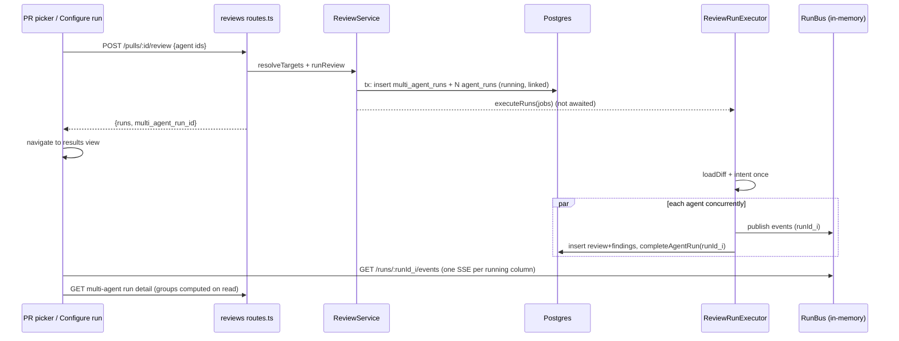

# Spec: Multi-Agent Review — parallel specialist reviewers, grouped findings, visible disagreement
Spec ID: SPEC-14
Status: final (approved 2026-10-12)
Supersedes: none

> **Worktree A boundary.** This spec covers only: the PR detail page's agent
> picker, the Multi-Agent Review screens (Configure run, results, run list),
> and the review / multi-run service on the server (`server/src/modules/reviews/**`,
> including in-place edits to `routes.ts`, `service.ts` and `run-executor.ts`,
> plus any new multi-run files, shared contracts and one migration). It does
> **not** touch `ci/`, `agent-runner/`, or the `source: 'ci'` path of
> `agent_runs`. Anything that would need a change there is out of scope here.

> **Lesson number (decision S1).** Root `README.md:90` lists "Multi-agent
> review" under **L07**, so this file is `L07-multi-agent-review.md`. This was
> confirmed over the original request for a lesson-free slug, to match the
> repo's lesson-prefixed naming.

**Relationship to the existing review flow.** This spec **extends**
`server/specs/review-flow.md`. It does not replace it. The same endpoint
(`POST /pulls/:id/review`), the same `ReviewService.runReview` entry point and
the same `ReviewRunExecutor.executeRuns` run every agent. Every rule in
`review-flow.md` still holds: rows are created `running` up front, there is no
`pending` state, the route never awaits `executeRuns`, repo-intel stays
best-effort, the prompt stays byte-identical when repo-intel is off, the
lifecycle is `running → done|failed|cancelled`, and stale runs are reaped at
boot. Three things change. (1) `RunRequest` gains a third selector, an explicit
agent set. (2) That selector also creates one `multi_agent_runs` parent row and
links every child `agent_runs` row to it. (3) The per-agent loop in
`executeRuns` runs agents in parallel instead of one after another. That last
change applies to every caller, including the legacy `all: true` path.
`review-flow.md` itself is not edited by this spec. Updating its "Per-agent
execution" prose after implementation is a doc task.

**Design images.** These were supplied at Windows temp paths outside the repo.
They should be copied to `specs/assets/L07-multi-agent-review/1.png`…`5.png`,
following the precedent of `specs/assets/L06-eval-pipeline/`:

| # | Original path | Shows |
|---|---|---|
| 1 | `/mnt/c/Users/OLENA~1.ANT/AppData/Local/Temp/emdash-drop-409fff3a-bcae-490a-b8c6-19b3aeffe1c4-paste.png` | PR #482 page. The "Run Review" button opens a "PICK AGENTS TO RUN" popover with a "Clear" link, two checked agents each showing a `~6s` hint, a "Run multi-agent review (2)" button and a "Configure agents…" link |
| 2 | `/mnt/c/Users/OLENA~1.ANT/AppData/Local/Temp/emdash-drop-68850d23-1332-45c3-a1dc-d170d130e0c8-paste.png` | Empty "Run a Multi-Agent Review" screen. Step 1 "Select a pull request…". Step 2 "Pick a pull request first" placeholder. A "Run multi-agent review (4)" button is shown enabled |
| 3 | `/mnt/c/Users/OLENA~1.ANT/AppData/Local/Temp/emdash-drop-f7fd1dbc-312a-4cb2-8df0-e3f9c06516d0-paste.png` | Filled Configure screen. PR #482 is selected. Five agent cards (Security, Performance, Junior Mentor, Customer-Facing, Architecture), each with a checkbox, a one-line preview and `time · $cost`. A "Select all" link. Footer reads `≈ 8.2s · $0.20 · parallel fan-out` |
| 4 | `/mnt/c/Users/OLENA~1.ANT/AppData/Local/Temp/emdash-drop-8b24a952-468b-498f-9344-7106d0cce773-paste.png` | Results, **Columns** mode. Header has "Configure run", "4 selected agents · parallel", a Columns/Tabs switch and `4 agents · … · 8.2s total · $0.20`. Four agent columns each have a score ring, time, cost, finding rows (title + `file:line`), "View trace" and "N findings". Below is "WHERE AGENTS DISAGREE" with two location rows and a "Show only conflicts" toggle (off) |
| 5 | `/mnt/c/Users/OLENA~1.ANT/AppData/Local/Temp/emdash-drop-b4ea6570-84b1-4a0e-bbc1-b47da371332d-paste.png` | Results, **Tabs** mode. Each agent tab has a score. The selected agent's summary card shows the score ring, summary, "View trace", time and cost. Findings expand to show category, `file:line`, `NN% conf`, rationale, "SUGGESTED FIX" and the buttons Accept / Dismiss / Learn / Turn into eval case / Reply to author. The same disagreement block sits below |

No image shows: the run list / history, a running or failed column, a column
with zero findings, the picker with zero agents, or the results page while
loading. The user accepted building these as specified here without a bespoke
design (decision S2): a minimal run list, and spinner plus live log for
running columns, with no fake progress-ring percentage. Criteria that depend on
them are marked **(no design; behaviour as specified here was accepted,
decision S2)**.

## Problem and user

**INSIGHTS entries that bear on this task (loaded this session):**

- `server/INSIGHTS.md` 2026-10-09, **deepseek hangs, bound every call in a
  sequential loop.** The per-agent loop at
  `server/src/modules/reviews/run-executor.ts:154` is the loop this spec makes
  parallel. `REVIEW_LLM_TIMEOUT_MS` stays the per-agent bound.
  `withTimeout` does not cancel the request, so a timed-out call may still cost
  money (see Open questions, cost honesty).
- `server/INSIGHTS.md` 2026-10-09, **the stale-run sweep needs an age
  filter.** Children are created `running` up front. The 60-minute sweep cutoff
  still applies unchanged. Parallel execution makes young `running` rows
  shorter-lived, not longer.
- `server/INSIGHTS.md` 2026-10-09, **eval `must_not_flag` matches on file +
  line overlap only, and models often report wide ranges.** The grouping
  heuristic reuses `matches()` semantics (`server/src/modules/eval/scoring.ts:51-59`),
  so wide ranges will over-group. Decision D4 addresses this.
- `server/INSIGHTS.md` 2026-10-08, **changing linked skills does not bump
  `agents.version`.** The time/cost estimate averages historical
  `agent_runs` per `agent_id`, so it can mix skill configurations. This is
  accepted as a known v1 limitation.
- `server/INSIGHTS.md` 2026-09-21, **run events are never persisted.**
  Live per-column status uses the in-memory `RunBus` SSE stream. The source of
  truth for status is the `agent_runs` row, not the stream.
- `server/INSIGHTS.md` 2026-09-21, **cross-module data access goes through
  `container.<x>Repo`.** Multi-run code must not import
  `server/src/modules/eval/scoring.ts` or `agents/repository.ts` directly.
  Agents come through `container.agentsRepo` (`server/src/platform/container.ts:103`).
- `client/INSIGHTS.md` 2026-09-18, **promote on the second consumer.**
  `RunTraceDrawer` lives in the PR route's `_components/`. The results page is
  its second consumer, so it moves to `client/src/components/` in the same change.
- `client/INSIGHTS.md` 2026-09-18, **severity colours come from `SEV` /
  `SeverityBadge` only.** This applies to column finding rows and disagreement cells.
- `client/INSIGHTS.md` 2026-09-18, **count badges come from the same pipeline
  stage as their filter.** This applies to "N findings" per column.
- `client/INSIGHTS.md` 2026-09-17 (superseded 09-27), **diff
  `client/src/vendor/shared` against the server copy before editing.** New
  contracts go server-first, then get synced.
- Root `INSIGHTS.md`: no entry bears on this feature.

**Who and what.** A reviewer opening a PR such as #482 ("Add rate limiting to
public API endpoints") wants security, performance, mentoring, customer-impact
and architecture opinions in one pass. Today:

- The PR page's "Run Review" menu (`client/src/app/repos/[repoId]/pulls/[number]/_components/RunReviewDropdown/RunReviewDropdown.tsx:41-82`)
  offers only "Run all enabled agents" or one agent. You cannot pick an
  arbitrary subset.
- `ReviewRunExecutor.executeRuns` runs agents one after another
  (`run-executor.ts:154-191`). A four-agent review takes the sum of four
  latencies.
- `multi_agent_runs` exists (`server/src/db/schema/runs.ts:69-78`, created in
  `0000_init.sql:198`), but nothing writes it and no column links `agent_runs`
  to it. The runs of one batch cannot be told apart from other runs on the
  same PR.
- No code groups findings across agents. Two agents flagging the same line
  show up as two unrelated cards. An agent staying silent on a line another
  agent flagged is never shown.
- No screen shows per-agent cost and time side by side before or after a run.

## Goals / Non-goals

**Goals**
- Pick any subset of agents from two entry points (the PR page popover and a
  standalone Configure run screen). Both end up as one `multi_agent_runs` row
  and the same results view.
- Run the selected agents in parallel inside the existing executor process,
  with per-agent failure isolation.
- Group findings across the batch by file + line-range overlap, keeping every
  original finding and its agent.
- Show, per location, every agent in the batch: flagged with a severity, "did
  not flag", or not finished or failed. Offer a "Show only conflicts" filter.
- Offer two results views, Columns (live per-agent status) and Tabs + detail.
  Both reuse `RunTraceDrawer` / `LiveLogStream` and the existing finding actions.
- Show the real time and cost of each run, plus a pre-run estimate from history.

**Non-goals**
- Real git-worktree isolation. "fan-out via worktrees" in the mockup is flavour
  text. No worktree lifecycle.
- Any LLM call beyond the agents' own review calls. That means no generated
  "why I did not flag this" text and no LLM-based dedupe.
- Embeddings or semantic similarity. `EMBEDDINGS_ENABLED` stays `false`.
- Changes to `ci/`, `agent-runner/`, MCP (`mcp/`), or the `source: 'ci'` run path.
- A new "Learn → memory" capability (L07 Persistent memory, a separate feature).
- Persisting run events or persisting finding groups. Groups are computed on read.
- Filtering estimates by agent version or skill snapshot.
- Redesigning `RunTraceDrawer`. It is moved, not changed (criterion 60).
- Cancel-all, re-run-one-agent, and comparing two multi-agent runs (see Open
  questions, UX proposals).

## User stories

1. As a reviewer on a PR page, I tick the agents I want and start them all at
   once without leaving the page.
2. As a reviewer on the Multi-Agent Review screen, I pick a PR and agents and
   see the expected time and cost before I spend anything.
3. As a reviewer, I watch each agent's progress in its own column, and a
   failing agent does not hide the others' results.
4. As a reviewer, I see where agents agree, where only one agent spoke, and
   where they gave different severities, without reading every list.
5. As a reviewer, I read one agent's findings in detail (confidence, suggested
   fix) and accept, dismiss, or turn them into eval cases.
6. As a reviewer, I open any agent's run trace from the results page exactly as
   I do on the PR page.
7. As a reviewer, I find a past multi-agent run again, wherever I started it from.

## Acceptance criteria (EARS)

### A. Entry points and convergence

1. [Ubiquitous] The system shall provide two entry points for a multi-agent
   review, the PR detail page agent picker and a standalone Configure run
   screen in the Multi-Agent Review section. Both shall submit the same
   request shape (criterion 12) to `POST /pulls/:id/review`.
2. [Event-driven] WHEN a multi-agent review starts from either entry point, the
   system shall create exactly one `multi_agent_runs` row, and the run shall
   appear in the same results view and run list as runs started from the other
   entry point.
3. [Event-driven] WHEN the user opens the "Run Review" control on the PR page,
   the system shall show a "Pick agents to run" popover listing the
   workspace's agents with a checkbox each, a "Clear" action, a
   "Run multi-agent review (N)" button where N is the number checked, and a
   "Configure agents…" link. This popover replaces the old "Run all
   enabled agents" / single-agent menu (decisions D1, D2).
4. [Ubiquitous] Each agent row in the PR page popover shall show that agent's
   estimated duration (criterion 61). When no estimate exists, it shall show a
   "no estimate" marker, never `0s`.
5. [Event-driven] WHEN the user clicks "Configure agents…" in the popover, the
   system shall navigate to the Agents list (`/agents`), as the existing
   dropdown does today (`RunReviewDropdown.tsx:81`) (decision D10).
6. [Event-driven] WHEN the user opens the Configure run screen without a PR
   selected, the system shall show step 1 "Pull request" with a PR selector and
   step 2 "Agents to run" as a disabled placeholder reading "Pick a pull request
   first".
7. [Event-driven] WHEN a PR is selected on the Configure run screen, the system
   shall list the workspace's agents as cards, each with a checkbox, the agent
   name, a one-line preview, and that agent's estimated duration and cost. It
   shall also show a "Select all" action. All agents are listed, enabled ones pre-checked and
   disabled ones selectable (D2). The preview is that agent's latest `done`
   review `summary` on the selected PR, falling back to the agent's
   `description` (D3). Cards use one neutral accent and the `Cpu` icon (D9).
8. [Ubiquitous] The Configure run screen shall show, next to its run button, the
   aggregate estimate for the checked agents: time is the **maximum** of the
   checked agents' estimated durations (they run in parallel), and cost is the
   **sum** of their estimated costs (criteria 61-62).
9. [State-driven] WHILE zero agents are checked, or (on the Configure run
   screen) no PR is selected, the system shall disable the
   "Run multi-agent review (N)" button.
10. [State-driven] WHILE the start request is in flight, the system shall
    disable the run button and show its loading state, so a double click cannot
    create a second batch.
11. [Event-driven] WHEN the start request succeeds from either entry point, the
    system shall navigate to the results view of the returned
    `multi_agent_run_id` (decision D6).

### B. Request contract and run creation (server)

12. [Ubiquitous] `RunRequest` (`server/src/vendor/shared/contracts/platform.ts:372-375`)
    shall gain an optional third selector: a non-empty array of agent ids, each
    validated as a uuid. The exact field name is frozen by the planner
    (suggested `agentIds`). The change shall be additive, so the existing
    `agentId` and `all` callers, including MCP (`mcp/src/api/client.ts:115-117`),
    keep working unchanged.
13. [Unwanted behavior] IF a request supplies more than one of
    `agentId` / `all` / the agent-id array, or none of them, THEN the system
    shall reject it with the existing 400 `invalid_run_request` error
    (`server/src/modules/reviews/service.ts:60`) and create no rows.
14. [Unwanted behavior] IF any id in the agent-id array does not resolve to an
    agent in the caller's workspace, THEN the system shall respond 404 and
    create neither a `multi_agent_runs` row nor any `agent_runs` row.
15. [Ubiquitous] The system shall run each distinct agent id in the array at
    most once per request. Duplicate ids shall not create duplicate child runs.
16. [Event-driven] WHEN a valid agent-id-array request arrives, the system shall
    create one `multi_agent_runs` row (`workspace_id`, `pr_id`, `ran_at`) and one
    `running` `agent_runs` row per selected agent, each linked to that parent, in
    one transaction, before `executeRuns` is fired.
17. [Ubiquitous] The `POST /pulls/:id/review` response (`ReviewRunResponse`,
    `server/src/vendor/shared/contracts/review-api.ts:53-57`) shall gain an
    additive, nullable `multi_agent_run_id`. It is set for agent-id-array
    requests and null or absent for `agentId` / `all` requests.
18. [Ubiquitous] Requests made with `agentId` or `all: true` shall not create a
    `multi_agent_runs` row, and their `agent_runs` rows shall carry a null
    parent link.
19. [Ubiquitous] Children of a multi-agent run shall remain ordinary
    `agent_runs` rows with `source: 'local'`. They keep appearing in
    `GET /pulls/:id/runs`, `GET /pulls/:id/runs/active`, `GET /pulls/:id/reviews`,
    the PR page's run history and agent stats exactly as single runs do.
20. [Ubiquitous] A new migration, generated with `pnpm db:generate` and never
    hand-written, shall add a nullable `multi_agent_run_id` uuid column on
    `agent_runs`, foreign-keyed to `multi_agent_runs.id`, plus indexes that
    support (a) listing a parent's children by `(workspace_id, multi_agent_run_id)`
    and (b) listing parents by `(workspace_id, pr_id, ran_at)`. The planner
    freezes the on-delete behaviour of the FK (suggested `SET NULL`) and the
    exact index names.
21. [Ubiquitous] Every new repository query on `multi_agent_runs` or on the new
    link column shall filter by `workspace_id`.

### C. Parallel execution (server)

22. [Ubiquitous] `ReviewRunExecutor.executeRuns` shall keep loading the diff and
    deriving intent **once** before fan-out (`run-executor.ts:99-152`). It shall
    then start `runOneAgent` for every job concurrently in the same process, and
    wait for all of them with settle-all semantics (`Promise.allSettled` or
    equivalent). This replaces the sequential loop at `run-executor.ts:154-191`.
23. [Unwanted behavior] IF one agent's `runOneAgent` rejects, times out
    (`REVIEW_LLM_TIMEOUT_MS`), or is cancelled, THEN the other agents in the
    batch shall continue to completion. The failing agent's row shall be
    persisted `failed` or `cancelled` with its `error` and trace, exactly as
    `run-executor.ts:415-439` does today.
24. [Unwanted behavior] IF the shared pre-work fails (diff load), THEN the
    system shall fail every child run via the existing `failAll` path
    (`run-executor.ts:78-97`), and the parent shall read as failed (criterion 69).
25. [Ubiquitous] The shared intent-derivation cost shall still be attributed to
    exactly one child run of the batch (today the job at index 0,
    `run-executor.ts:170`). Parallel execution shall not double-count it.
26. [Ubiquitous] Parallel execution shall not change any agent's assembled
    prompt. The byte-identical-prompt invariant in `review-flow.md` holds per agent.
27. [Ubiquitous] Each child run shall still publish to its own `RunBus` channel
    keyed by its own `agent_runs.id`. No new event persistence shall be added.

### D. Finding grouping (server, computed on read)

28. [Ubiquitous] The system shall group the findings of a multi-agent run's
    completed child reviews by location. Two findings belong to the same group
    when their `file` strings are exactly equal (case-sensitive) and their closed
    line ranges overlap after min/max normalisation of `start_line`/`end_line`.
    These are the same semantics as `matches()` in
    `server/src/modules/eval/scoring.ts:51-59`.
29. [Ubiquitous] The grouping function shall be a pure, I/O-free helper owned
    by the multi-run code. It shall not import from `server/src/modules/eval/`
    (cross-module rule, `server/INSIGHTS.md` 2026-09-21).
30. [Ubiquitous] Overlap shall be transitive. If finding A overlaps B and B
    overlaps C, then A, B and C form one group, even when A and C do not
    overlap (decision D4).
31. [Ubiquitous] Grouping shall never mutate, merge or drop an original finding.
    Each group shall reference its member findings by finding id, and every
    finding shall keep its `review_id` and so its agent attribution. Every
    finding of every completed child review shall belong to exactly one group.
32. [Ubiquitous] Each group shall expose: a stable identifier that does not
    change across refetches of the same data, `file`, the union line range
    (`start_line` = minimum, `end_line` = maximum over members), a headline
    (the title of the member with the highest severity, ties broken by higher
    `confidence`, then lower `start_line`), and the member finding ids.
33. [Ubiquitous] Groups shall be computed on the server and returned to the
    client. The client shall not recompute grouping or conflict status.
34. [Ubiquitous] Groups shall be ordered by highest member severity first, then
    by `file`, then by `start_line`.

### E. "Where agents disagree"

35. [Ubiquitous] For every group, the system shall return one verdict entry per
    child run in the batch, covering **every selected agent** including those
    with zero findings anywhere in the PR. Each entry shall carry the run id,
    agent id and name, and a state of `flagged`, `did_not_flag`, `running`,
    `failed` or `cancelled`.
36. [Ubiquitous] A `flagged` entry shall carry the highest severity among that
    agent's findings in the group, that agent's member finding ids, and the
    title of its highest-severity finding in the group.
37. [Ubiquitous] An entry shall be `did_not_flag` only when that child run
    finished with status `done` and has no finding in the group. A run that is
    still running, failed or was cancelled shall be shown in that state and
    never as "did not flag".
38. [Ubiquitous] A `did_not_flag` entry shall render as a plain "did not flag"
    label with no explanatory text. The system shall make no LLM call to
    generate a reason.
39. [Ubiquitous] The system shall mark a group as a **conflict** when, among the
    entries in state `flagged` or `did_not_flag`, either (a) at least one is
    `flagged` and at least one is `did_not_flag`, or (b) two or more `flagged`
    entries carry different highest severities. Entries in `running`, `failed`
    or `cancelled` state shall not count toward conflict (decision D5).
40. [State-driven] WHILE "Show only conflicts" is off (the default), the block
    shall list every group. WHILE it is on, the block shall list only groups
    marked as conflicts (decision D5).
41. [State-driven] WHILE the toggle is on and no group is a conflict, the block
    shall show an empty state saying the agents agree on every flagged
    location. **(no design; behaviour as specified here was accepted, decision S2)**
42. [State-driven] WHILE the batch has fewer than two child runs, the system
    shall hide the "Where agents disagree" block (decision D1).
43. [Ubiquitous] Each disagreement row shall show `file:start_line`, the group
    headline, and one cell per child run in the batch's run order. The
    severity is shown with `SeverityBadge` / `SEV` tokens, never with a local
    colour map.
44. [Ubiquitous] The "Where agents disagree" block and its toggle shall be shown
    identically below both the Columns and Tabs views.

### F. Results page — Columns view

45. [Ubiquitous] The results page shall show a header with a "Configure run"
    action, the PR number and title, the number of selected agents, the total
    cost (criterion 65), the total duration (criterion 66), and a
    Columns / Tabs view switch. Copy shall say the agents ran "in parallel" and
    shall not claim git worktrees. The scaffold string
    `client/messages/en/runs.json:123` ("fan-out via p-queue") shall be replaced
    rather than reused verbatim.
46. [Event-driven] WHEN the user clicks "Configure run" on the results page, the
    system shall open the Configure run screen pre-filled with this run's PR and
    agent set (decision D10).
47. [Ubiquitous] The Columns view shall render one column per child run, in the
    order the agents were submitted. Each column header shows the agent name,
    its duration and cost (criterion 64), and its score as a ring
    (`CircularScore` from `@devdigest/ui`) once the run is `done`.
48. [State-driven] WHILE a child run is `running`, its column shall show a
    running indicator in place of the score, plus a compact `LiveLogStream`
    (`client/src/vendor/ui/LiveLogStream.tsx:20-28`) fed by that run's own SSE
    stream (`GET /runs/:id/events`), one subscription per running child.
    **(no design; behaviour as specified here was accepted, decision S2)**
49. [Event-driven] WHEN a child run's SSE stream ends, the system shall refetch
    the multi-agent run detail. The column's state shall come from the persisted
    `agent_runs.status`, not from the stream.
50. [State-driven] WHILE a child run is `done`, its column shall list that run's
    findings (severity icon, title, `file:line`) and a footer with "View trace"
    and "N findings". N equals the number of rows the column actually renders.
51. [State-driven] WHILE a child run is `done` with zero findings, its column
    shall show its score and an empty state ("no findings"), and "View trace"
    stays available. **(no design; behaviour as specified here was accepted, decision S2)**
52. [Unwanted behavior] IF a child run is `failed` or `cancelled`, THEN its
    column shall show the status, the persisted `agent_runs.error` text, and its
    real duration and cost (criterion 64). It shall show no score, and "View
    trace" stays available. The other columns shall be unaffected.
    **(no design; behaviour as specified here was accepted, decision S2)**
53. [Ubiquitous] Columns shall stay usable for any number of agents in the
    batch: they wrap or scroll horizontally, with no fixed four-column limit.
    The mockup shows four columns. A workspace can have more agents.

### G. Results page — Tabs + detail view

54. [Ubiquitous] The Tabs view shall render one tab per child run, labelled with
    the agent name and its score when `done`. A running, failed or cancelled run
    shows a status indicator in place of the score. Selecting a tab shows that
    agent's summary card (score ring, review `summary`, duration, cost, "View
    trace") and its findings.
55. [Ubiquitous] Findings in the Tabs view shall render with the existing shared
    `FindingCard` (`client/src/components/finding-card/FindingCard.tsx:27-46`),
    which already shows category, `file:line`, confidence (`ConfidenceNum`),
    rationale and "Suggested fix". Accept and Dismiss shall call the existing
    `POST /findings/:id/accept|dismiss` routes
    (`server/src/modules/reviews/routes.ts:195-205`) through the existing
    `useFindingAction` hook (`client/src/lib/hooks/reviews.ts:223`).
    "Turn into eval case" shall use the existing `EvalCaseModalProvider` /
    `useEvalCaseModal().openForFinding`
    (`client/src/components/eval-case-modal/EvalCaseModalProvider.tsx:23-30`, backed by
    `GET /findings/:id/eval-draft`, `server/src/modules/eval/routes.ts:54-61`),
    with the page wrapped in the provider and `prId` set. Its existing
    "enabled only once decided" rule (`FindingCard.tsx:127-146`) stays as is.
    No new finding-action endpoint is added.
56. [Ubiquitous] The "Learn" button shown in design image 5 shall not be
    rendered in v1. `actOnFinding` rejects `learn` with 400 `invalid_action`
    today (`server/src/modules/reviews/findings.ts:31-32`), and Learn → memory
    is outside worktree A (decision D7).
57. [Event-driven] WHEN a finding action succeeds on the results page, the
    system shall refresh the multi-agent run detail so the Columns view, the
    Tabs view and the disagreement block all reflect the new accepted or
    dismissed state.

### H. Run trace reuse (both views)

58. [Event-driven] WHEN the user clicks "View trace" on any column (Columns
    view) or on the summary card (Tabs view), the system shall open the
    **existing** `RunTraceDrawer`, scoped to that one child run's
    `agent_runs.id`, exactly as the PR page does for a single run today.
    The same sidebar shows the same sections: Trace tab (Configuration, Stats,
    Prompt assembly, Tool calls, Raw output, Findings), Live log tab
    (`LiveLogStream`), and the footer "Copy raw output". No new sidebar and no
    new section shall be designed. The drawer's existing prop contract
    (`client/src/app/repos/[repoId]/pulls/[number]/_components/RunTraceDrawer/RunTraceDrawer.tsx:19-29`,
    default export at `:36`) is used as is:

    | Prop | Value on the results page |
    |---|---|
    | `runId: string` | the child's `agent_runs.id` |
    | `agentName?: string \| null` | the child's agent name |
    | `prNumber?: number \| null` | the batch PR's number |
    | `findings?: FindingRecord[]` | that child review's findings (empty when none) |
    | `running?: boolean` | `true` while that child's status is `running` (opens on the Live log tab and streams SSE, `RunTraceDrawer.tsx:45-46`) |
    | `onClose: () => void` | closes the drawer |

59. [Ubiquitous] The results page shall track the open drawer the way the PR
    page does: a `trace=<runId>` search param (`page.tsx:86`, `:248-255`), so a
    trace link can be shared and survives a reload. Only one drawer is open at a time.
60. [Ubiquitous] Because the results page is `RunTraceDrawer`'s second consumer
    route, the folder shall be **moved** from
    `client/src/app/repos/[repoId]/pulls/[number]/_components/RunTraceDrawer/`
    to `client/src/components/run-trace-drawer/` in the same change, together
    with its `_components/`, `constants.ts`, `helpers.ts`, `styles.ts` and
    tests. The PR page import is updated to match (`client/INSIGHTS.md`
    2026-09-18; `frontend-ui-architecture` import direction). The move shall not
    change the drawer's props, behaviour, sections, i18n namespace (`runs`) or
    rendering. No other change to `RunTraceDrawer` is needed or allowed by this spec.

### I. Time / cost estimate

61. [Ubiquitous] The server shall provide, in one request, a per-agent estimate
    for the workspace's agents: `sample_size`, average `duration_ms` and average
    `cost_usd`. Each average is computed over that agent's historical
    `agent_runs` rows in the workspace with `status = 'done'` and a non-null
    value for the measured field, all-time. The 30-day, all-status
    `GET /agents/:id/stats` averages are deliberately not reused (decision D8).
62. [Unwanted behavior] IF an agent has no qualifying runs for a field, THEN the
    estimate for that field shall be null, and the UI shall show "no estimate"
    for it and never `$0.00` or `0s`. The aggregate (criterion 8) shall then be
    marked partial ("≥") and shall not treat the null as zero.
63. [Ubiquitous] Each estimate shall be labelled as an estimate (for example a
    `≈` / `~` prefix) and kept visually distinct from real post-run figures.

### J. Real cost and time (results page)

64. [Ubiquitous] A child's shown cost and duration shall be its persisted
    `agent_runs.cost_usd` and `agent_runs.duration_ms`. A null cost shall render
    as "unknown", never as `$0` (`runs.ts:32`: "null when unknown (never means free)").
65. [Ubiquitous] The batch total cost shall be the sum of the children's non-null
    `cost_usd`. When any finished child has a null cost, the total shall carry a
    partial marker. The total shall include failed children's recorded cost when
    one is recorded.
66. [Ubiquitous] The batch total duration shall be the wall-clock span from the
    parent's `ran_at` to the latest child completion. Until every child has
    finished, it shall read as in progress. The planner decides whether this is
    derived from child `ran_at + duration_ms` or from a stored parent field.

### K. Multi-agent run read model and run list

67. [Ubiquitous] The server shall expose a workspace-scoped read of one
    multi-agent run by id. It returns the parent (id, PR id/number/title,
    `ran_at`, derived status, totals), each child as a `RunSummary`
    (`server/src/vendor/shared/contracts/trace.ts:116`) plus its `ReviewRecord`
    (`review-api.ts:24-38`) or null, and the groups and verdicts from sections D–E.
    The response shall be validated by a new shared Zod contract added to
    `server/src/vendor/shared/` first and then synced to `client/src/vendor/shared/`.
68. [Unwanted behavior] IF the requested multi-agent run id is not a uuid, THEN
    the system shall respond 422 (`IdParams`, `server/src/modules/_shared/schemas.ts:11`).
    IF it does not exist in the caller's workspace, THEN the system shall
    respond 404.
69. [Ubiquitous] The parent's status shall be derived from its children, never
    stored: `running` if any child is `running`; otherwise `done` if all
    children are `done`; `failed` if no child is `done`; `partial` otherwise.
70. [Ubiquitous] The Multi-Agent Review section shall list past multi-agent runs
    newest first, each showing PR number and title, agent count, derived status,
    total cost and when it ran. Each entry links to its results view, whichever
    entry point started it. The list shows only runs whose PR belongs to the
    **active repository**, the same scoping as the Pull Requests list
    (decision S3). It is a minimal table or list with no bespoke design
    (decision S2).
71. [Ubiquitous] A parent whose children have all been deleted
    (`DELETE /runs/:id`) shall not appear in the run list, and its detail read
    shall respond 404.
72. [Ubiquitous] A "Multi-Agent Review" sidebar entry shall link to the section.
    The route shall contain `/multi-agent` so the existing active-key logic
    (`client/src/components/app-shell/helpers.ts:28`) highlights it. Adding the
    entry to `client/src/vendor/ui/nav.ts` is a scoped vendor exception with the
    same precedent comments as `nav.ts:26-38`. Only this one entry is added. The
    mockup's other GLOBAL items (Memory, Agent Performance, CI Runs) belong to
    other features.

### L. States and failures (both views)

73. [State-driven] WHILE the multi-agent run detail is loading, the results page
    shall show skeleton columns or tabs (`Skeleton` from `@devdigest/ui`).
    **(no design; behaviour as specified here was accepted, decision S2)**
74. [Unwanted behavior] IF the multi-agent run detail request fails, THEN the
    results page shall show an error state with a retry action, routed through
    the app's existing `ApiError` handling. **(no design; behaviour as specified here was accepted, decision S2)**
75. [State-driven] WHILE the workspace has no agents, both entry points shall show
    an empty state linking to `/agents` instead of a picker, and the run button
    shall not render. The existing scaffold copy at
    `client/messages/en/runs.json:124-128` may be reused.
    **(no design; behaviour as specified here was accepted, decision S2)**
76. [State-driven] WHILE the active repository has no pull requests, the
    Configure run PR selector shall show an empty state, and step 2 shall stay
    disabled. **(no design; behaviour as specified here was accepted, decision S2)**
77. [Unwanted behavior] IF the start request fails (404 PR or agent, 400, 422,
    429 rate limit, network), THEN the entry point shall stay on screen, keep
    the user's selection, and surface the error through the app's existing error
    toast. No navigation shall occur.
78. [Ubiquitous] All new user-facing copy shall go through `next-intl` keys. All
    domain types shall come from `@devdigest/shared`. UI primitives (`Checkbox`,
    `Tabs`, `Toggle`, `CircularScore`, `SearchableSelect`, `Drawer`,
    `EmptyState`, `Skeleton`) shall come from `@devdigest/ui` before anything is
    hand-rolled. The `@devdigest/ui` `Dropdown` closes on item click and has no
    checkbox items (`client/src/vendor/ui/kit/types.ts:5-16`), so the PR page
    picker is a feature-local popover component and not a vendor edit.

## Edge cases

**Missing states (design analysis bucket 1)** — no design for any of these:
- A running column or tab (criterion 48). The mockup's "progress ring" shows a
  final score. RunEvents carry no percentage (`trace.ts` `RunEvent` has only
  `kind`/`msg`/`data`), so a real progress fraction is not available. The spec
  uses an indeterminate indicator plus the live log. Open.
- A failed or cancelled column (52), a zero-findings column (51), page loading
  (73) and page error (74).
- No agents (75), no PRs (76), and the run list (70).
- Popover with zero agents checked (9). The mockup only shows 2 checked.

**Corner cases (bucket 2)**
- **Mockup inconsistency 1.** Image 2 shows "Run multi-agent review (4)"
  enabled with no PR and no agents chosen. Criterion 9 resolves this as disabled.
- **Mockup inconsistency 2.** Images 4 and 5 list **Architecture** ("did not
  flag") in the disagreement rows although Architecture was not selected (4
  selected agents). They also show only 3 of the 4 selected agents per row.
  Criterion 35 resolves this: every child of the batch appears, and only those.
- **Mockup inconsistency 3.** Image 4's Security column flags
  `src/middleware/ratelimit.ts:52` ("Retry-After header omitted on 429"), yet
  the `ratelimit.ts:52` disagreement row shows Security "did not flag".
  Computed verdicts (criterion 37) would show Security as flagged.
- **Mockup inconsistency 4.** The per-agent reason lines under "did not flag"
  ("Not a security concern.") are flavour text. They are dropped per settled
  decision 2 (criterion 38).
- **Single agent selected.** Criterion 42 hides the disagreement block. See D1.
- **Wide ranges.** One finding spanning lines 1–200 can pull a whole file's
  findings into one group under transitive grouping (D4, `server/INSIGHTS.md`
  2026-10-09).
- **Same agent, two findings in one group.** The verdict cell shows the highest
  severity and that finding's title. All member ids stay attached (criterion 36).
- **Dismissed or accepted findings** stay in groups and count as `flagged`.
  Whether a dismissed finding should count is an open question.
- **Agent deleted after the run.** `agent_runs.agent_id` is `ON DELETE SET NULL`
  (`runs.ts:24`), so the agent name can be null. Columns, tabs and verdicts must
  render a fallback label and must not crash.
- **Child run deleted** via `DELETE /runs/:id` (`routes.ts:143-147`). The batch
  shrinks, and if every child is gone the parent disappears (criterion 71).
- **Server restart mid-batch.** Boot reaping flips every `running` child to
  `failed` (`review-flow.md` "Stale-run reaping"). The parent then derives
  `failed` or `partial`. SSE replay buffers are gone, so columns rely on
  `agent_runs.status` (criterion 49).
- **Late open of the results page after completion.** `RunBus.complete` keeps
  the buffer only briefly (`server/src/platform/sse.ts:76-83`). Completed
  columns must not depend on SSE.
- **Two batches on the same PR at once.** Allowed, the same as the existing
  flow. Each has its own parent and children. The per-route rate limit of
  10/min (`routes.ts:54`) still applies.
- **Disabled agents.** The existing dropdown lets a disabled agent run
  individually (`RunReviewDropdown.tsx:51-53`). D2 keeps that for the picker.
- **Concurrent provider calls.** N simultaneous OpenRouter calls may hit
  provider rate limits (429). Each is isolated per agent (criterion 23), and
  there is no concurrency cap in v1 (settled decision 1).
- **Long titles and paths** in narrow columns must truncate with the full text
  available on hover. **(no design; behaviour as specified here was accepted, decision S2)**
- **Intent cost on child 0.** The first child's cost includes the shared intent
  derivation (criterion 25), so its historical average, and therefore its
  estimate, is inflated relative to its siblings.

### Cross-module dependencies

| Dependency | Direction | Where |
|---|---|---|
| `agents` module (agent lookup, list for picker) | reads via `container.agentsRepo` | `server/src/platform/container.ts:103`, `service.ts:50-61` |
| `RunBus` SSE (per-child live log) | reads | `routes.ts:75-120`, `server/src/platform/sse.ts` |
| `eval` module (draft eval case from a finding, create case) | triggers existing endpoints from the client only. No server import | `server/src/modules/eval/routes.ts:54-83` |
| Finding actions (accept/dismiss) | triggers existing endpoints | `routes.ts:195-205` |
| Run trace (`GET /runs/:id/trace`) | reads via `RunTraceDrawer` → `useRunTrace` | `routes.ts:161-170`, `client/src/lib/hooks/trace.ts:12` |
| `pulls` / `usePulls` (PR selector) | reads | `client/src/lib/hooks/core.ts:100` |
| `@devdigest/reviewer-core` `reviewPullRequest` (per agent, unchanged) | triggers | `run-executor.ts:282-318` |
| MCP (`mcp/src/api/client.ts:115-117`) | consumer of `POST /pulls/:id/review` with `agentId`. Must keep working (criterion 12) | not edited |

Request flow for a multi-agent start (several hops):

## Non-functional requirements

- **Latency.** A batch's wall-clock time should approach the slowest agent's
  time, not the sum. Each agent is still bounded by `REVIEW_LLM_TIMEOUT_MS`.
- **No extra LLM spend.** The feature adds zero LLM calls beyond each selected
  agent's own review (settled decision 2). Grouping and conflict detection are
  deterministic.
- **Grouping cost.** Grouping is O(n²) per file over the batch's findings
  (n is typically tens). It is computed per read, and no cache is required.
- **Accessibility.** Checkboxes, the view switch, tabs and the conflicts toggle
  must be keyboard-operable and labelled. State (running, failed, did not flag)
  must not be conveyed by colour alone. The design uses dot plus text, so keep the text.
- **i18n.** Every label goes through `next-intl`. Counts follow
  `client/INSIGHTS.md` 2026-09-18 (no thousands separators from `{count}`).
- **Rate limit.** The existing `POST /pulls/:id/review` limit (10/min,
  `routes.ts:54`) stays. A multi-agent start counts as one request.

## Inputs and provenance

| Input | Source | Validated today |
|---|---|---|
| `:id` (PR id) on `POST /pulls/:id/review` | URL path | `IdParams` uuid, `server/src/modules/_shared/schemas.ts:11`, via the route `schema.params` at `server/src/modules/reviews/routes.ts:50` (runs in Fastify's validation stage, before the handler). Workspace ownership is checked in `service.ts:117-118` (`getPull(workspaceId, prId)` → 404) |
| `agentId` (legacy) | request body | `RunRequest`, `server/src/vendor/shared/contracts/platform.ts:373`, is `z.string().optional()`. **No uuid check.** Ownership is checked by `agents.getById(workspaceId, …)` at `service.ts:56-57` |
| `all` (legacy) | request body | `platform.ts:374` `z.boolean().optional()` |
| Agent-id array (new) | request body | **none found**. It is new and must be added to `RunRequest` as uuid strings with `min(1)` (criterion 12). Every id must be resolved in the workspace before any insert (criterion 14) |
| Empty or `null` body | request body | `z.preprocess((v) => v ?? {}, RunRequest)` at `routes.ts:45`. The selector-exclusivity check (criterion 13) must live in `resolveTargets`, because `RunRequest` alone accepts `{}` |
| Multi-agent run id (results page, detail read) | URL path | **none found** (new route). Use `IdParams` |
| `trace` search param on the results page | URL query (client) | **none found** on the client. The server validates `:id` via `IdParams` on `GET /runs/:id/trace` (`routes.ts:163`) |
| `:id` on `POST /findings/:id/(accept\|dismiss)` | URL path | `IdParams` at `routes.ts:198`. Workspace check in `server/src/modules/reviews/findings.ts:17-19` |
| Finding fields (`file`, `start_line`, `end_line`, `severity`, `title`, `confidence`, `suggestion`) used for grouping and display | LLM output, persisted | `Finding` schema, `server/src/vendor/shared/contracts/findings.ts:47-67` (validated as structured LLM output), then the grounding gate in reviewer-core. **Nothing enforces `start_line <= end_line`**, hence min/max normalisation (criterion 28) |
| Historical `agent_runs.duration_ms` / `cost_usd` for estimates | DB, written by `completeAgentRun` | written from engine-reported values (`run-executor.ts:359-370`). There is no schema-level validation beyond the column types (`server/src/db/schema/runs.ts:29-33`) |
| `RunSummary` / `ReviewRecord` returned to the client | DB → DTO | response schemas `trace.ts:116`, `review-api.ts:24-38`, serialized by `fastify-type-provider-zod` (`server/INSIGHTS.md` 2026-09-21: `safeParse` runs before `JSON.stringify`) |

## Untrusted inputs

| Field | Boundary crossed | Current server-side validation |
|---|---|---|
| Agent-id array in `POST /pulls/:id/review` body | browser → API | none found (new; criterion 12 adds uuid + `min(1)`, criterion 14 adds the workspace check) |
| `agentId` in `POST /pulls/:id/review` body | browser / MCP → API | `server/src/vendor/shared/contracts/platform.ts:373` (string only), plus the workspace lookup at `server/src/modules/reviews/service.ts:56-57` |
| `:id` PR id in `POST /pulls/:id/review` | browser → API | `server/src/modules/_shared/schemas.ts:11` via `server/src/modules/reviews/routes.ts:50` |
| Multi-agent run id in the new detail read | browser → API | none found (new; must use `IdParams` + a workspace-scoped lookup) |
| `:id` run id on `GET /runs/:id/trace` and `GET /runs/:id/events` (opened per child by `RunTraceDrawer`) | browser → API | `server/src/modules/reviews/routes.ts:77` and `:163` (uuid only). **Neither route scopes the run to the caller's workspace.** `getContext` is called but `workspaceId` is unused (`routes.ts:79`, `:165-166`). This gap already exists and is not widened by this spec |
| Finding `title` / `rationale` / `suggestion` / `file` rendered in columns, tabs, verdict cells | LLM output (influenced by PR diff and PR body, which are untrusted) → browser | `server/src/vendor/shared/contracts/findings.ts:47-67` (shape only). Rendering must keep going through the existing `Markdown` primitive / text nodes, with no raw HTML |
| Agent `name` / `description` shown on cards | user-authored agent config → browser | `server/src/vendor/shared/contracts/knowledge.ts:391-394` (shape only). Render as text |

## Decisions (confirmed by the user, 2026-10-12)

All are settled and binding. Each one is referenced inline by its ID.

- **S1. Filename.** The lesson prefix `L07` follows `README.md:90`.
- **S2. Screens and states with no design.** The run list is a minimal
  table or list. Running, failed, empty and loading states are built as
  specified: spinner plus live log, and no fake progress-ring percentage,
  because run events carry no progress fraction (criteria 41, 48, 51, 52, 70,
  73–76).
- **S3. Run list scope** is the active repository only, consistent with the
  Pull Requests list (criterion 70).
- **D1. The PR picker replaces the old menu** (criteria 3, 9, 42). The PR
  page picker replaces the "Run all enabled agents" / per-agent menu. Any
  selection of 1 or more agents creates a parent run. With one agent the
  disagreement block is hidden. Why: one path, one record type, one results view.
- **D2. All agents are listed** (criteria 3, 7). Enabled agents are
  pre-checked and disabled ones stay selectable, matching today's
  `RunReviewDropdown.tsx:51-53`.
- **D3. Card preview** (criterion 7). The preview is that agent's latest
  `done` review `summary` on the selected PR, falling back to `description`
  (`knowledge.ts:394`). Why: the mockup preview is PR-specific.
- **D4. Grouping is transitive** (criterion 30), using connected components.
  The over-grouping risk from wide ranges is accepted (edge cases).
- **D5. "Show only conflicts"** (criteria 39, 40). Off shows every group. On
  shows only groups whose finished agents differ: one flagged and another did
  not, or the severities differ.
- **D6. Navigate after start** (criterion 11). Starting from the PR page goes
  straight to the results view.
- **D7. No "Learn" in v1** (criterion 56). There is no endpoint for it.
- **D8. Estimate source** (criterion 61). The estimate is the all-time average
  over `status = 'done'` runs with non-null values. The 30-day, all-status
  `GET /agents/:id/stats` averages
  (`server/src/modules/agents/repository.ts:323-345`) are not used, because
  they count failed runs' durations.
- **D9. No per-agent colour or icon** (criterion 7). Cards use a neutral
  accent and the `Cpu` icon, with no schema change.
- **D10. Navigation links** (criteria 5, 46). "Configure agents…" goes to
  `/agents`. The results page's "Configure run" opens the Configure screen
  pre-filled with the same PR and agent set.
- **RunTraceDrawer is promoted** to `client/src/components/run-trace-drawer/`
  in the same change, as a pure move with no prop or behaviour change
  (criterion 60, second-consumer rule).

## Open questions

Known limitations (accepted for v1, not to be solved here):

- Estimates can mix runs from different skill configurations of the same agent,
  because `agents.version` does not bump on skill changes
  (`server/src/modules/agents/service.ts:156`, `server/INSIGHTS.md` 2026-10-08).
- The estimate for whichever agent tends to run first is inflated by the shared
  intent cost (criterion 25).
- **Cost honesty gap.** A failed or timed-out child records `cost_usd: null`
  (`run-executor.ts:422-433`), even though the abandoned call may still be
  billed (`withTimeout` does not cancel). The UI shows "unknown", not `$0`, but
  the real spend is not captured.

Other open points:

- Should a **dismissed** finding still count as `flagged` in verdicts and
  conflict detection? Today it does (edge cases).
- `review-flow.md`'s "Per-agent execution" section and the `run-executor.ts`
  comments ("agents run one after another", `:278-281`) become stale after
  criterion 22. Update them in the implementation change.

UX proposals (not requirements; accept or reject):

- [UX proposal] "Reply to author" is shown in design image 5 but was not in the
  request. It could reuse the existing `POST /pulls/:id/comments`
  (`server/src/modules/pulls/routes.ts:281`, hook `useCreatePrComment`,
  `client/src/lib/hooks/reviews.ts:191`).
- [UX proposal] Clicking a finding row in the Columns view switches to the
  Tabs view with that finding expanded.
- [UX proposal] Clicking a disagreement cell for a `flagged` agent jumps to
  that agent's finding.
- [UX proposal] A "Cancel all" action while the batch is running (today only
  per-run `POST /runs/:id/cancel` exists, `routes.ts:150-158`).
- [UX proposal] "Re-run failed agents" on a `partial` batch.
- [UX proposal] On the PR page's run history, mark child runs that belong to a
  multi-agent batch and link to its results (an additive
  `multi_agent_run_id` on `RunSummary`).
